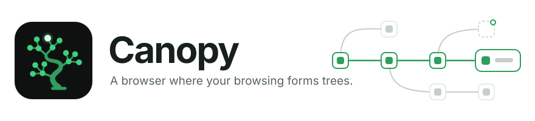
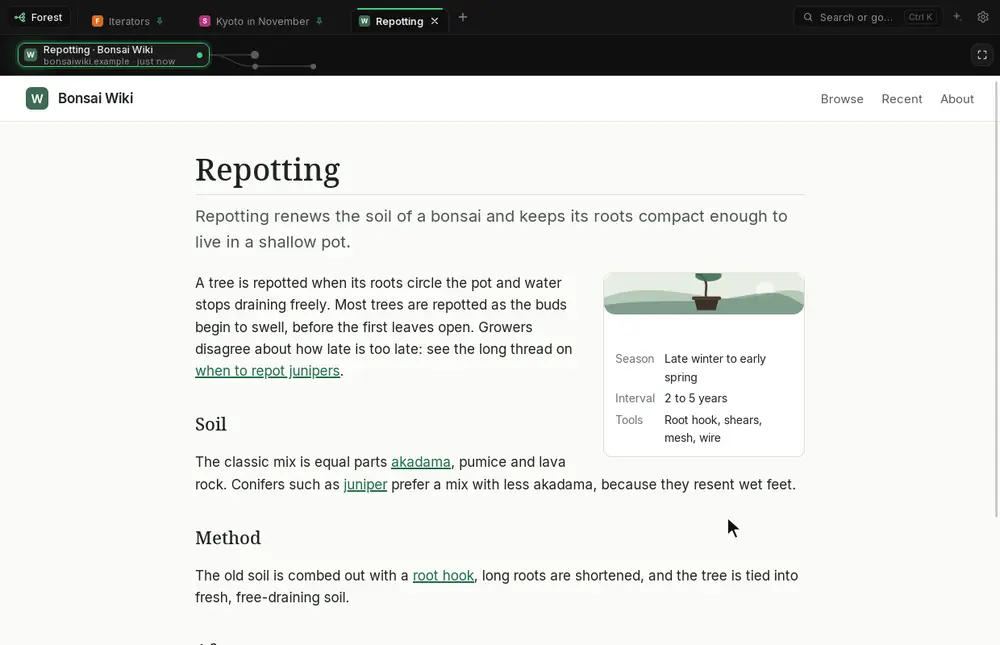
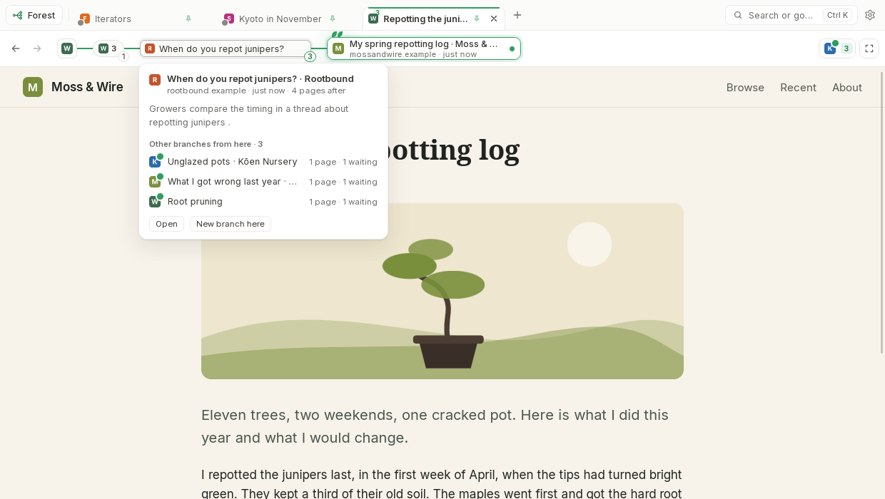
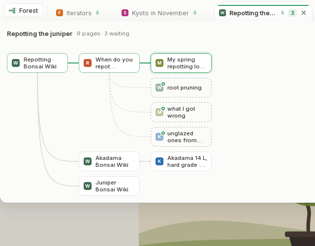
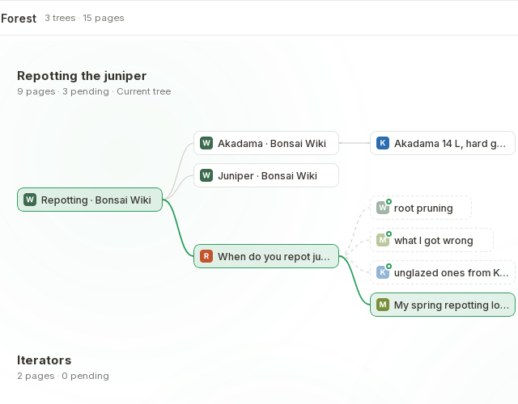
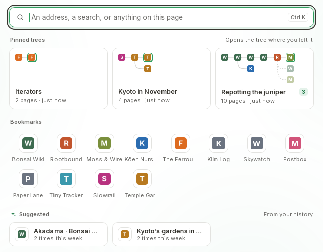
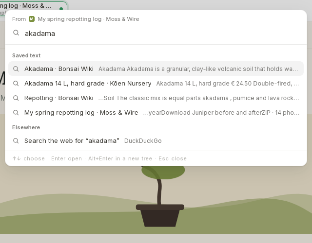
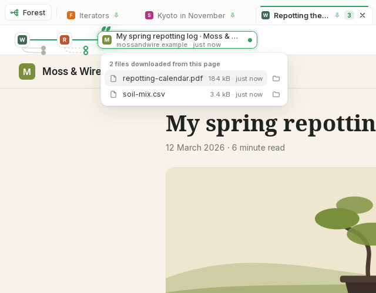

<p align="center">
  <picture>
    <source media="(prefers-color-scheme: dark)" srcset="docs/assets/banner-dark.svg">
    <source media="(prefers-color-scheme: light)" srcset="docs/assets/banner-light.svg">
    
  </picture>
</p>

<p align="center">
  A Linux browser written in Rust that remembers <b>how you got there</b>. Every page keeps the page it came from, so going back and following another link grows a second branch instead of losing the first.
</p>

<p align="center">
  
  
  
  
  
</p>

<p align="center">
  
</p>

<p align="center">
  <sub>One tree growing: a link followed, three left waiting for later, another followed, then the strip opened over the page.</sub>
</p>

<p align="center">
  <a href="#quick-start">Quick start</a> ·
  <a href="#what-it-is">What it is</a> ·
  <a href="#a-look-inside">A look inside</a> ·
  <a href="#what-it-does">What it does</a> ·
  <a href="#keyboard">Keyboard</a> ·
  <a href="#install-it">Install it</a> ·
  <a href="#working-on-canopy">Working on Canopy</a> ·
  <a href="#how-it-is-built">How it is built</a>
</p>

<table align="center">
  <tr>
    <td align="center" width="290"><a href="#quick-start"><b>Try it</b></a><br>Build it, run it, grow your first fork.</td>
    <td align="center" width="290"><a href="docs/guide.md"><b>Read the guide</b></a><br>Every feature, step by step.</td>
    <td align="center" width="290"><a href="#working-on-canopy"><b>Work on Canopy</b></a><br>Run the checks, read the design notes.</td>
  </tr>
</table>

## Quick start

1. **Install the build tools and libraries:** stable Rust, GTK 3, WebKitGTK 4.1, SQLite, and the two programs WebKit's sandbox needs.

   ```sh
   # Debian or Ubuntu
   sudo apt install build-essential pkg-config libgtk-3-dev libwebkit2gtk-4.1-dev libsqlite3-dev bubblewrap xdg-dbus-proxy

   # Arch Linux
   sudo pacman -S --needed base-devel pkgconf gtk3 webkit2gtk sqlite bubblewrap xdg-dbus-proxy
   ```

2. **Run it** from the project folder:

   ```sh
   cargo run --locked
   ```

3. **Grow a fork.** Press **Ctrl+K**, type an address and press **Enter**. Follow a link. Click the first page in the strip under the tabs, then follow a different link. Both pages now hang under the first one, and neither is lost.

Good to know:

- Close Canopy and start it again: the trees and the page you were on are kept.
- Your data lives in `~/.local/share/canopy`. To try Canopy without touching it, run `cargo run --locked -- --data-dir .data`.
- `canopy --import-chrome` brings your Chrome history, bookmarks, cookies and saved passwords ([how it works](docs/guide.md#bring-your-chrome-history)).
- If the window does not start, or video plays green on an NVIDIA card, see [Sandbox and video](docs/guide.md#sandbox-and-video).

## What it is

A tab bar is a flat list. It forgets which page led to which, and going back to try another link throws away where you had been. Canopy keeps that shape. Each visit records its parent, each search or typed address starts a new tree, and the tabs at the top are whole trees, not single pages.

Under the tabs, a strip draws the tree you are in: the path to the current page, with small buds for the other branches. Rest the pointer on it and it opens over the page with every branch. Click any page to return to it.

A tree is also a place to keep things. Links you open with a middle click wait in the tree until you read them. Files you download hang as leaves on the page they came from. The text of the pages you read is saved, so a few remembered words find the page again, along with the comment that linked to it.

> [!NOTE]
> **Prototype.** Canopy is a personal browser in active development and runs on Linux only. It has no extensions, no list of all downloads, no editor for saved logins, and resuming a page does not restore its forms. The [guide](docs/guide.md) says plainly what each feature does not do yet.

## A look inside

Every picture here is the real window, taken by the test suite while it browses a small made-up web about repotting a bonsai. They follow your GitHub theme: Canopy has a dark and a light theme, and starts dark.

<table>
  <tr>
    <td width="50%" align="center">
      <picture>
        <source media="(prefers-color-scheme: dark)" srcset="docs/assets/shots/card-dark.webp">
        
      </picture>
      <br><sub><b>The strip.</b> Every branch of the tree, one hover away. A card tells you what each page was.</sub>
    </td>
    <td width="50%" align="center">
      <picture>
        <source media="(prefers-color-scheme: dark)" srcset="docs/assets/shots/tree-dark.webp">
        
      </picture>
      <br><sub><b>Waiting pages.</b> Middle-click links to keep them in the tree, drawn dashed until you read them.</sub>
    </td>
  </tr>
  <tr>
    <td width="50%" align="center">
      <picture>
        <source media="(prefers-color-scheme: dark)" srcset="docs/assets/shots/forest-dark.webp">
        
      </picture>
      <br><sub><b>The forest.</b> Every tree on one canvas. Pan, zoom, and click a page to return to it.</sub>
    </td>
    <td width="50%" align="center">
      <picture>
        <source media="(prefers-color-scheme: dark)" srcset="docs/assets/shots/start-dark.webp">
        
      </picture>
      <br><sub><b>A new tree.</b> Pinned trees reopen where you left them, above bookmarks and suggestions from your habits.</sub>
    </td>
  </tr>
  <tr>
    <td width="50%" align="center">
      <picture>
        <source media="(prefers-color-scheme: dark)" srcset="docs/assets/shots/palette-dark.webp">
        
      </picture>
      <br><sub><b>Search what you read.</b> The palette finds words inside pages you visited, not only titles.</sub>
    </td>
    <td width="50%" align="center">
      <picture>
        <source media="(prefers-color-scheme: dark)" srcset="docs/assets/shots/files-dark.webp">
        
      </picture>
      <br><sub><b>Downloads are leaves.</b> A file stays attached to the page it came from.</sub>
    </td>
  </tr>
</table>

## What it does

Each heading links to its part of the [guide](docs/guide.md).

### [Trees instead of tabs](docs/guide.md#find-your-way-around)

- One tab per tree, named after what you searched for or after its first page. Right-click to rename it.
- The strip shows the path to the current page and opens on hover to show every branch.
- A card on each page gives its title, site and where it was found, with **New branch here** to start from that page without loading it.
- **Ctrl+E** opens the forest, with every tree on one canvas.
- **Ctrl+W** settles a tree: it leaves the tabs, keeps every page, and comes back when you open one of them. Pinned trees stay on the new-tree page.

### [Read now, read later](docs/guide.md#resume-reading)

- **Ctrl+click** or **middle-click** a link and its page waits in the tree, with the comment or passage it was linked from.
- A counter at the end of the strip shows how many pages wait. **Ctrl+Tab** opens the next one.
- Canopy saves the text of the pages you read, or only the passage you select with **Ctrl+S**. Form fields are left out, and a page showing a password form is not saved automatically.
- **Ctrl+K** searches titles, addresses and saved text. A saved passage opens offline, with a way back to its source.

### [A new-tree page that knows your habits](docs/guide.md#find-your-way-around)

- **Ctrl+T** shows pinned trees, bookmarks and up to three suggestions from your own history, each with the reason it is there.
- Keep a suggestion as a bookmark or a pinned tree, or dismiss it for good.
- Until Canopy has history of its own, your busiest Chrome sites fill in.

### [Downloads that stay in context](docs/guide.md#download-files)

- A file is saved straight to your download folder, never over an existing file.
- It shows as a green leaf on the page it came from. Click the leaf to open the file or its folder.
- Move or delete the file and the leaf turns hollow.

### [Logins, yours or your password manager's](docs/guide.md#sign-in-with-a-saved-login)

- Saved logins live in an encrypted vault whose key stays in your system keyring.
- Nothing is filled until you ask, with the key button or **Ctrl+Shift+L**, and only on the exact site the login was saved for.
- Canopy offers to save a login once the site has let you in.
- Prefer your own manager? `canopy --login-helper bitwarden` uses Bitwarden through its `bw` tool, and a [helper for another manager](docs/guide.md#write-a-helper) is a small program that answers three questions in JSON.

### [Coming from Chrome](docs/guide.md#bring-your-chrome-history)

- `canopy --import-chrome` reads history, bookmarks, cookies and saved passwords while Chrome stays open.
- Sites whose sessions still work stay signed in.
- Imported history is searchable and fills suggestions, and plants no trees of its own.

### [A good desktop citizen](docs/guide.md#open-links-from-other-apps)

- `canopy URL…` opens each address as a new tree. If Canopy is already running, the links go to that window.
- It can be your default browser: `xdg-settings set default-web-browser canopy.desktop`.
- Pages run inside WebKit's sandbox.

## Keyboard

| Keys | What they do |
| --- | --- |
| **Ctrl+K**, **Ctrl+L** | Open the palette: search your forest and saved text, or go to an address. **Ctrl+L** selects the current address. |
| **Enter**, **Alt+Enter** | In the palette, open the result here, or in a new tree. |
| **Ctrl+T** | New-tree page. Start typing to search in a new tree. |
| **Ctrl+1** to **Ctrl+9** | Switch to a tree. |
| **Ctrl+W** | Settle the current tree. |
| **Ctrl+E** | The forest: every tree. |
| **Ctrl+Shift+E** | The current tree in a larger view. |
| **Alt+Left** | Back to the parent page. |
| **Ctrl+Tab** | Next waiting page of this tree. |
| **F6** | Move the keyboard between the page and the strip. **Left** and **Right** walk the path. |
| **Ctrl+D** | Bookmark the page, or remove its bookmark. |
| **Ctrl+S** | Remember the selected passage. |
| **Ctrl+Shift+L** | Fill the saved login. |
| **Ctrl+R**, **F5** | Reload. |
| **Ctrl+Q** | Quit. |

## Install it

To build an optimized binary into `~/.local/bin` and add Canopy to rofi, wofi or your desktop menu:

```sh
cargo install --path . --locked --root ~/.local
install -Dm755 helpers/canopy-login-bitwarden ~/.local/bin/canopy-login-bitwarden
install -Dm644 packaging/canopy.desktop ~/.local/share/applications/canopy.desktop
install -Dm644 assets/logo/canopy.svg ~/.local/share/icons/hicolor/scalable/apps/canopy.svg
for size in 16 22 24 32; do
  install -Dm644 assets/logo/canopy-small.svg ~/.local/share/icons/hicolor/${size}x${size}/apps/canopy.svg
done
```

Run the first command again after pulling changes. The binary embeds its font, so it does not need the project folder. The simpler `canopy-small.svg` replaces the icon at 32 pixels and below, where the full drawing blurs.

To make Canopy your default browser, so links clicked in other apps open in it:

```sh
xdg-settings set default-web-browser canopy.desktop
```

## Working on Canopy

```sh
cargo fmt --check
cargo test --locked
cargo clippy --locked --all-targets -- -D warnings
```

The GUI suites drive the real window with pointer and keyboard input under Xvfb, and check the chrome through its own DOM. [Working on Canopy](docs/development.md) explains how to run them all, where things live in the source, and how to retake the pictures on this page with one command.

`rust-toolchain.toml` selects stable Rust for this project only. It does not change your default version elsewhere.

## How it is built

Canopy is one Rust program. WebKitGTK shows the pages, one live web view per branch you keep open. The chrome (tabs, strip, palette, cards, forest) is HTML drawn by a transparent web view over the page. SQLite holds the forest, and one module is its only writer.

The design notes explain the choices and what was rejected:

- [A forest of visits](docs/design.md): the data model, and why SQLite owns the forest and the cursor.
- [The memory of an exploration](docs/reading-memory.md): waiting links, saved text and the search over them.
- [Themes an agent can write](docs/theming.md): a design for chrome themes as one JSON file. Not built yet.

## License and credits

Canopy is MIT-licensed, as declared in `Cargo.toml`. It ships the [Inter](https://rsms.me/inter/) typeface in `assets/fonts/`, under the SIL Open Font License in `assets/fonts/LICENSE.txt`.

The sites in the pictures (Bonsai Wiki, Rootbound, Moss & Wire, Kōen Nursery and the others) do not exist. They are served by the test suite from `tests/readme_site`.
